<div align="center">

<picture>
  <source media="(prefers-color-scheme: dark)" srcset=".github/assets/banner-dark.svg">
  
</picture>

**Put useful application state on the home screen.**<br>
Publish typed widget state and deep links to Android App Widgets and iOS WidgetKit without running the full application UI.

[](https://packagist.org/packages/pushinbr/pam-native-widgets)
[](https://github.com/push-in/pam-native-widgets/releases/latest)

[](https://github.com/push-in/pam-native-widgets/actions/workflows/ci.yml)
[](LICENSE)

[Install](#install) · [Quick example](#quick-example) · [Platforms](#platform-support) · [API](#api) · [Docs](#docs) · [Issues](https://github.com/push-in/pam-native-widgets/issues)

</div>

<a id="install"></a>
## <picture></picture> Install

Inside a PAM Native project, add only this capability:

```sh
pam composer require pushinbr/pam-native-widgets
pam doctor --fix
```

Autolinking creates the WidgetKit extension, shared entitlements, Android receiver, resources and native bridge. Use `pam packages` to inspect installed capabilities and `pam composer remove pushinbr/pam-native-widgets` to uninstall.

New to PAM? Create a project with `pam init my-app --template native` (see the [PAM Native overview](https://push-in.github.io/pam-docs/native/overview/)).

<a id="quick-example"></a>
## <picture></picture> Quick example

```php
use Pam\Native\Widgets\WidgetContent;
use Pam\Native\Widgets\Widgets;

(new Widgets())->update(
    'account-summary',
    new WidgetContent(
        title: 'Available balance',
        subtitle: 'Updated just now',
        value: '$1,284.00',
        deepLink: 'myapp://account',
    ),
    static fn (bool $updated, ?string $error) => null,
);
```

Widgets are not a background PHP runtime: prepare their display model in the app, then call `Widgets::update()`. State goes through process-safe shared storage; on iOS that is the app group `group.<application-id>.pam-native`, shared by the generated app and widget targets. Keep values small and non-sensitive because they can appear while the device is locked. The identifier is stable application metadata, not a per-device widget instance ID.

<a id="platform-support"></a>
## <picture></picture> Platform support

| Platform | Support | Notes |
| --- | --- | --- |
| Android | API 26+ | App Widget receiver `PamWidgetProvider`; no permissions declared |
| iOS | 16.0+ | WidgetKit, SwiftUI; generated `PamWidgets` extension and app group entitlement |
| PAM Native | 0.8.0 to < 2.0.0 | From `pam-native.plugin.json`; PHP 8.5+ |

<a id="what-you-can-build"></a>
## <picture></picture> What you can build

- Glanceable dashboards and status cards
- Shortcuts into high-value app actions
- Schedules, habits, finance and media widgets

| | |
| --- | --- |
| **Native path** | Android App Widgets · WidgetKit |
| **Application model** | Composer package + generated native integration |
| **Design rule** | Independent module; no feed, vertical or application template bundled |

<a id="api"></a>
## <picture></picture> API

| API | Responsibility |
| --- | --- |
| `Widgets::update(string $identifier, WidgetContent $content, Closure $complete)` | Publish bounded, process-safe widget state; `$complete(bool $updated, ?string $error)` |
| `WidgetContent(title, subtitle, value, deepLink)` | Title (at most 128 bytes), subtitle (256), value (128) and an optional `scheme://` deep link (2048) |

Widget content is intentionally bounded; use deep links to open rich application screens.

<a id="production-checklist"></a>
## <picture></picture> Production checklist

- Treat widgets as snapshots, not background PHP processes.
- Keep lock-screen-visible content small and non-sensitive.
- Use stable widget identifiers and valid deep links into named routes.
- Run `pam doctor`, `pam test`, and a signed release build on every supported platform.
- Exercise denial, cancellation, backgrounding, process restart and offline behavior before release.

<a id="troubleshooting"></a>
## <picture></picture> Troubleshooting

- **iOS widget is empty:** verify the shared app group and extension signing.
- **Android widget is stale:** publish new state before requesting refresh.
- **A deep link opens the wrong screen:** validate it through the main app router.
- **Native integration is stale:** run `pam doctor --fix`, rebuild the native host, and inspect the first reported diagnostic.

Platform SDKs, credentials, entitlements, physical hardware and store configuration remain application responsibilities. Report security vulnerabilities through the repository security policy or GitHub private vulnerability reporting, not a public issue.

<a id="docs"></a>
## <picture></picture> Docs

- [PAM Native overview](https://push-in.github.io/pam-docs/native/overview/)
- [Plugin and native capability model](https://push-in.github.io/pam-docs/native/plugins/)
- [PAM documentation](https://push-in.github.io/pam-docs/introduction/)
- [Changelog](CHANGELOG.md)
- [Report an issue](https://github.com/push-in/pam-native-widgets/issues)

<a id="pam-ecosystem"></a>
## <picture></picture> Part of the PAM ecosystem

PAM runs PHP natively on servers, desktops and phones. This repository is one piece of it.

| [**PAM**](https://github.com/push-in/pam) | [**PAM Desktop**](https://github.com/push-in/pam-desktop) | [**PAM Native**](https://github.com/push-in/pam-native) | [**Ecosystem**](https://github.com/push-in/pam#ecosystem) |
| --- | --- | --- | --- |
| the runtime and CLI | native desktop apps in PHP | native Android and iOS apps in PHP | every official package and plugin |

<sub>Docs: [push-in.github.io/pam-docs](https://push-in.github.io/pam-docs/introduction/) · [Issues](https://github.com/push-in/pam-native-widgets/issues)</sub>

<p align="center"><sub><a href="LICENSE">Apache License 2.0</a> · Made in Brazil by Pushin</sub></p>
